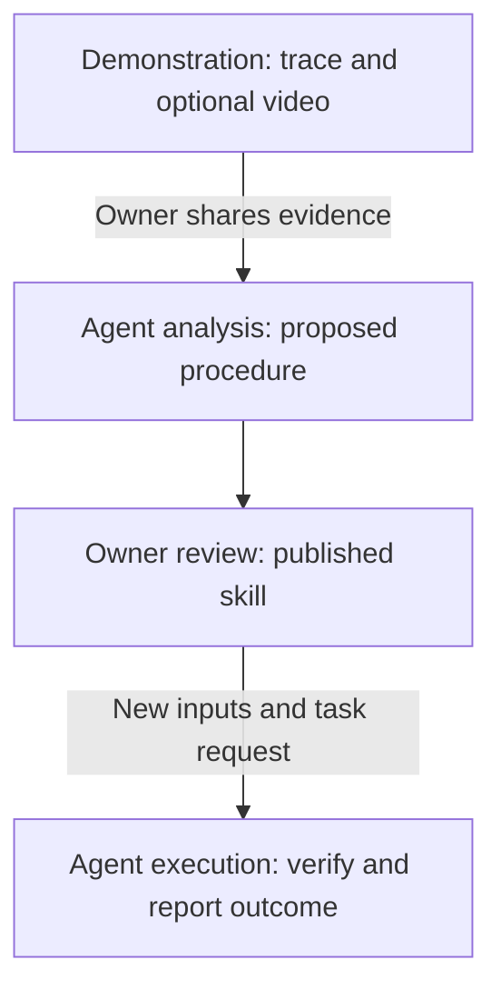

# Sendtry Computer

A computer to work in. Skills to work with.

`computer-mcp` is the technical repository and CLI for this Sendtry product.

Give your MCP agent a dedicated computer, and share its screen when you want to help.

This private MVP runs a dedicated **Linux desktop in Docker**, with Chromium,
a bounded command runner, a workspace file explorer, screenshots, bounded guest
mouse/keyboard input and **Teach**: record a demonstration, review reusable instructions and export
a `SKILL.md` pinned to its computer, workspace and reviewed revision. A small Node CLI
starts the computer; your harness launches a separate MCP bridge over stdio.
There is no model subscription, chatbot, gateway, cloud provisioning or Piblo
backend dependency.

Current product assessment, GitHub comparison and what remains before a public
preview: [market review](docs/MARKET.md), [release gaps](docs/READINESS.md) and
[executed validation](docs/VALIDATION.md). The current [screen-first design](docs/DESIGN-DIRECTION.md)
keeps work, teaching and setup clear. The [official Grok Bot comparison](docs/GROK-COMPARISON.md)
maps computer/Teach behavior, practical use and truthful gaps. Licensing/publication remains pending.

[Setup](docs/SETUP.md) · [Teach](docs/TEACH.md) · [Client acceptance](docs/CLIENT-VALIDATION.md) ·
[Distribution research](docs/DISTRIBUTION.md) · [Contributing](CONTRIBUTING.md)

## How a demonstration becomes a skill

Show the task on the agent's computer, let your connected agent understand the
evidence, review its proposed method, then ask it to do the task with new inputs.
This is the demonstration-to-skill experience we provide.



Finishing a recording saves a **completed workflow**, not a running analysis job.
It has a stable ID, name, goal, action trace and revision, with optional local
WebM evidence. With owner consent, `workflow_analyze` returns sampled images and
the trace. Your existing vision-capable agent interprets them and calls
`workflow_propose` to save a draft on that same workflow. The owner corrects the
procedure, supplies missing parameters and defines how to verify the result.
Only a completed, reviewed workflow can be exported as a taught `SKILL.md`.
The proposal can name inputs such as `csv_path` or `project_name`; the owner
reviews their descriptions alongside the procedure. Future trials ask for those
task values instead of requiring a raw recorded command. Definitions contain no
values/defaults and grant no new permissions.

There are **two explicit handoffs** today: send the copied analysis request to
your connected agent, then, after owner review, send a plan/execution request
with new inputs. Allowing frames, finishing a recording or copying a request
does not start inference or perform the task. Without video, the owner can
review the captured trace directly.

| Part               | What it does                                                                                                      |
| ------------------ | ----------------------------------------------------------------------------------------------------------------- |
| Your agent/harness | Supplies the model, image reasoning, conversation and tool calls.                                                 |
| Computer MCP       | Supplies one pinned Linux guest, evidence, bounded tools, access and control checks.                              |
| Operator skill     | Explains how to operate the computer and handle reviews, leases and failures.                                     |
| Taught skill       | Describes one owner-reviewed procedure, parameters and expected result, bound to the computer/workspace/revision. |
| A new task request | Asks the agent to plan or execute that procedure with current inputs; it is not a background job.                 |

[Grok Bot's documented Teach flow](https://docs.x.ai/grok-bot/skills-routines-and-automations#teach-a-workflow-by-demonstration)
also turns a demonstration into a draft skill for review/testing. Grok bundles
the Bot and orchestration; Sendtry uses your existing MCP agent. We do not claim
to reproduce Grok's internal analysis pipeline. See the
[source-backed comparison](docs/GROK-COMPARISON.md),
[complete Teach walkthrough](docs/TEACH.md#worked-example-teach-a-project-note)
and [tools/skills contract](docs/TOOLS-AND-SKILLS.md).
The [learning design](docs/LEARNING-DESIGN.md) explains reviewed task inputs;
[real harness evaluation](docs/LEARNING-EVALUATION.md) records generated skills,
cross-client reuse, independent checks and the failed setups we corrected.

## Start your first computer

Requirements: Node **22.13+**, Docker Engine **28+** with Compose v2 and a **local
Linux container engine**. On macOS/Windows, install Docker Desktop and start it.
The first build downloads Chromium and Linux desktop dependencies; later starts
reuse the image and data. Run these commands inside this private checkout:

```sh
npm ci
node src/cli.js --version
node src/cli.js doctor --context desktop-linux
node src/cli.js init --name my-computer --context desktop-linux
node src/cli.js start --name my-computer --open
node src/cli.js list
```

On Linux with a local Docker Engine, replace the doctor/init commands with:

```sh
node src/cli.js doctor --context default
node src/cli.js init --name my-computer --context default
```

Use the name of your validated local context if it differs from `default`.
The CLI always supplies the saved context explicitly and never changes your
Docker default. Remote SSH/TCP contexts are refused. When the machine’s default
context points at another computer, it is not used automatically on macOS or
Windows.

`doctor` works before the first computer exists. It checks prerequisites without
creating state or starting a guest. After setup it checks the selected computer's
ownership and, if running, its actual guest disk space. Host free space and guest
free space are reported separately; warnings are not a guarantee that a build or
recording will fit. [Diagnostic output and recovery](docs/SETUP.md).

The CLI prints the loopback console URL (the first free port starts at 17670).
The first computer becomes the CLI default. Take control to use the live
desktop, edit files or run commands. Release control to let the agent acquire its
own lease. Stop preserves the data:

```sh
node src/cli.js doctor --name my-computer
node src/cli.js status --name my-computer
node src/cli.js stop --name my-computer
```

Computers default to an **isolated/offline Docker network**. The included teaching
sandbox works offline. To use public websites or download dependencies, create a
separate computer with `init --name web-computer --context desktop-linux
--network internet`. Internet mode also allows connections to
reachable LAN/host services; it is not an outbound security firewall.

## Manage your computers

```sh
node src/cli.js init --name research --context desktop-linux --network internet
node src/cli.js list                 # Available, busy, unreachable; * is default
node src/cli.js use research         # Default for future CLI commands
node src/cli.js start --open
node src/cli.js status
```

Every computer has its own UUID, state, port, files and browser profile. Create
chooses a free port; it never takes over another listener. `use` does not move an
existing agent: generated MCP configurations remain fixed to their computer.
`start` preserves sessions when the selected computer is already ready; use
`start --rebuild` after a source update to rebuild/recreate it.

Existing state can be added with `register --state /private/existing/path`.
Selection is `--state` → `--name` → saved default. `--root /private/catalog`
isolates development/test catalogs. See [the local review workspace](docs/LOCAL-REVIEW.md)
for the existing demo computers. The **Computers** console view shows
registered PCs and copies exact owner commands. [Full command reference](docs/SETUP.md#computers-availability-and-default-selection).

## Connect an agent

Start the computer first, then generate a credential-free stdio configuration:

```sh
node src/cli.js config --name my-computer --access work
node src/cli.js config --name my-computer --client codex --access work
node src/cli.js config --name my-computer --client vscode --access work
node src/cli.js skill
```

Copy the JSON `mcpServers.computer` entry into your harness’s MCP settings (Claude
Code, Cursor or another stdio client). The second command emits a Codex TOML
entry; the third emits VS Code `servers` JSON. All use absolute Node/CLI/state paths, so harness working directories do
not matter. See [setup and harness notes](docs/SETUP.md). Real Claude Code and
Codex CLI agents passed work/read/control and video-to-reviewed-task scenarios;
see [harness validation](docs/HARNESS-VALIDATION.md) for versions and evidence.
Cursor CLI also passed actual project skill loading, read/work tasks and timeout
recovery. See [client acceptance](docs/CLIENT-VALIDATION.md), including initial
approval/cap failures and independent result checks. Persistent desktop/IDE
registration remains untested.

For observation-only access, generate configuration with `--access read`. The
bridge uses a distinct derived credential; the guest enforces that scope as well
as filtering the tool catalog. No runtime credential is printed in either
configuration. Keep the local state directory private: the owner’s credential
lives there, and any process able to read it has computer authority.

In **Connect agent → Start working**, check the connection, then choose
**Give your own task**. Describe the goal, success criterion and optional limits;
plan first or prepare an execution request and send it to your connected agent.
Both computer/workspace IDs are pinned. Copying starts no execution. Actual
Claude/Codex agents generated reports and reused taught tasks; see
[task assignment and recovery](docs/TASKS.md).

For a small first task, ask your agent to:

> Read computer_info, acquire control, explore the browser, write hello.txt in
> the workspace and run a command to read it. Capture a desktop screenshot and
> release control when finished.

Tools: `computer_info`, `control_acquire`, `control_renew`, `control_release`,
`browser_snapshot`, `browser_action`, `desktop_screenshot`, `desktop_action`, `terminal_run`,
`files_list`, `files_read`, `files_write`, `workflow_list`, `workflow_get`,
`workflow_analyze`, `workflow_propose`. MCP also exposes a pinned identity
resource and `computer-task`, `taught-workflow` and `analyze-demonstration` prompts.
`computer-task` prepares the same pinned plan/task as the console for clients
supporting prompts; retrieval performs no task. See [the prompt contract](docs/TASKS.md#prepare-a-task-directly-through-mcp).
For each tool's access, inputs, limits, control requirements and skill execution
flow, see [Tools and skills](docs/TOOLS-AND-SKILLS.md).

## Give the agent skills

Install the [operator skill](ui/skills/sendtry-computer/SKILL.md) in your
harness's project skill directory and verify that the client loads it.
**Connect agent** offers the same file; `node src/cli.js skill` prints it even
before setup. Downloading does not install it or authorize an MCP connection.
See [client-specific setup](docs/SETUP.md#console-connection-and-skills).

For a taught skill, complete the Teach loop above. **Confirm review** enables
**Export SKILL.md**. Save the export in the exact named skill folder shown by the
console. It pins computer/workspace/workflow/revision; re-export after review
changes. Review approval is not a verified successful run.

In **Try with new inputs**, supply task parameters and choose a plan (default)
or execution request. Send it to your connected agent. After acquiring control,
the agent must await another `workflow_get` ready/reviewed/exact-revision check
before any mutation, then verify the actual outcome and release its lease.
These review checks are instructions; generic action tools do not atomically
bind each effect to a workflow revision.

Video is optional, silent and local to the guest: five-minute capture deadline,
20 MiB per clip and 200 MiB total. Agent access delivers sampled PNGs, not the
owner-only raw WebM. Sampling can miss actions; it is not model training or
automatic coordinate replay. Consent applies to connected work agents for that
workflow. You can revoke future frame access or delete the video while retaining
the procedure; material already sent to a harness/provider cannot be recalled.
See [Teach privacy, states and recovery](docs/TEACH.md) and
[guest desktop limits](docs/DESKTOP.md).

## Review usage and activity

Open **Activity** in the owner console to inspect sessions, action outcomes,
time holding computer control and cumulative tool execution time. Filter by
session or the last 24 hours, 7, 30 or 90 days; export retained metadata as JSON
for your own future evaluations. History persists in that computer's private
volume across stops and rebuilds. It starts with this feature; older actions
are not reconstructed.

The bridge records the MCP client's declared name/version, access and session
ID. These identify a connection, not a verified person or model; shared
credentials can impersonate session IDs. Commands, paths, file content,
screenshots, video and raw errors are excluded from activity records. Exports
require the owner console; agent credentials cannot read history. Local
retention is bounded, and these timings are not billing or proof of task
success. See [the activity contract](docs/ACTIVITY.md).

## Try the offline practice task

1. In **Screen**, take control and open the practice task.
2. In **Teach & skills**, start a named recording, optionally with guest video.
3. Complete the form on the live guest screen.
4. Choose **Finish demonstration** to save and return to Skills. Review the trace, or
   allow your connected agent to analyze sampled video and propose instructions.
5. Correct the procedure, define a verifiable result and **Confirm review**.
   Export the skill, release control and ask your agent to reuse it with new
   supplied values.

[Teach guide](docs/TEACH.md) explains consent, drafts, limits and recovery.

## Platform support

| Server/CLI host                         | Guest provided by this MVP                                                   | Validation                                                                                                            |
| --------------------------------------- | ---------------------------------------------------------------------------- | --------------------------------------------------------------------------------------------------------------------- |
| macOS ARM64 + Docker Desktop            | Linux ARM64 desktop                                                          | Full CLI/MCP lifecycle passed locally and independently on a Mac mini via SSH                                         |
| Linux ARM64 + local Docker Engine       | Linux ARM64 desktop                                                          | Full 17-phase CLI/MCP lifecycle passed on Jetson AGX Thor; other Linux hosts untested                                 |
| Windows 11 x64 + Docker Desktop         | Linux AMD64 desktop                                                          | 17 functional phases passed with native Windows Node; preservation check flagged concurrent foreign-container removal |
| macOS/Windows/Linux native host control | Existing host desktop                                                        | Not implemented; requires explicit OS permissions and gives no agent-owned isolation                                  |
| macOS guest VM                          | Isolated macOS only with appropriate Apple hardware/licensing and VM adapter | Not implemented/tested                                                                                                |
| Windows guest VM                        | Windows VM with its own agent service and hypervisor adapter                 | Not implemented/tested                                                                                                |
| Remote owned computer                   | Authenticated adapter plus private transport and ownership verification      | Not implemented/tested                                                                                                |

Docker on a Mac or Windows machine does **not** create a macOS or Windows guest.
See [adapter boundaries](docs/ADAPTERS.md), [host QA and its limits](docs/HOST-VALIDATION.md)
and [validation evidence](docs/VALIDATION.md). Native Windows CLI testing used a
checkout path with spaces. Non-ASCII source paths failed in BuildKit on both new
hosts; doctor now warns before a build. These checks do not certify every OS,
Docker installation or editor integration.

## Boundaries and development

CI is intentionally disabled during this private development phase. The checks
below run locally; the Actions workflow is retained for future manual use.
See [QA and CI policy](docs/QA.md#manual-validation-and-ci-policy).

Every computer gets a UUID, pinned workspace UUID, unique Compose project,
network and named volume. No host workspace or Docker socket is mounted. Guest
commands run as UID 1000, while the control service and its state are private to
root. Human takeover cancels an active command; cancelling an in-flight browser
action can close that guest tab. Side effects that already happened are not
rolled back.

Use `open` to authorize the owner console with a short-lived, single-use ticket.
Agent work/read credentials cannot establish human sessions. The private host
state contains owner authority; there is no remote multi-user login system.
Raw VNC/CDP ports are not published;
VNC view/control sockets are separately authorized. Containers share a kernel,
Chromium currently runs without its sandbox, and shell process-group cleanup is
best effort against commands that daemonize. This MVP is for an owned agent
workspace, not arbitrary hostile-code hosting. Resource and storage limits are
explained in [SECURITY.md](SECURITY.md).

```sh
npm run format:check
npm run lint
npm run build
npm test
npm run check:package
npm run test:e2e -- --context desktop-linux
npm run test:integration -- /absolute/path/to/owned/computer/state
```

The [end-to-end runner](docs/QA.md) creates two fresh owned computers and stops
them after checking both network modes, MCP execution and restart persistence.
It retains private reports and volumes. Integration smoke changes only the selected owned computer, checks its labels
first and leaves small proof files/workflows. It does not launch/manage Docker
for you. Appearance and human control are reviewed manually. The console uses Sendtry's
warm paper/salmon identity; [product and design decisions](docs/PRODUCT.md) define
the tools → computer → taught-skill flow. Read
[arquitecture.md](arquitecture.md) for modules, identity, permissions, execution
and Teach flow; [reuse decision](docs/REUSE.md) explains Piblo separation.

**Private preview.** `private: true`, `UNLICENSED`. An open-source license,
dependency notice review, public packaging and release policy remain decisions
for a future explicitly authorized release. Nothing here publishes a package or
changes repository visibility.
The [distribution policy](docs/DISTRIBUTION.md) records primary-market research,
the private artifact check and a schema-checked draft Registry manifest. The
package is not on a public registry; use this authorized checkout today.
